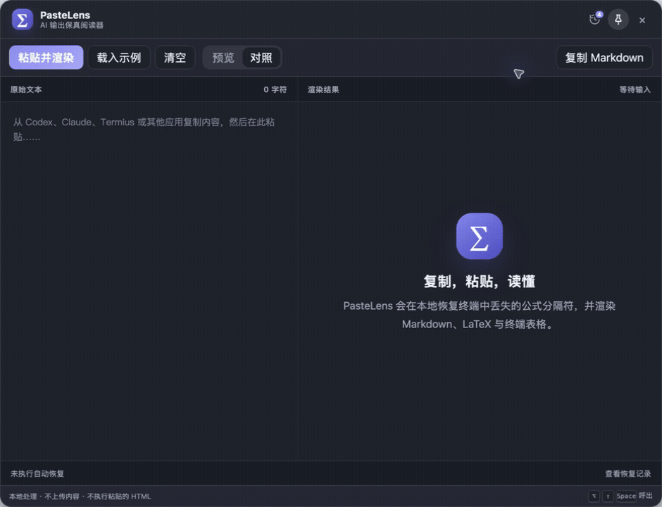
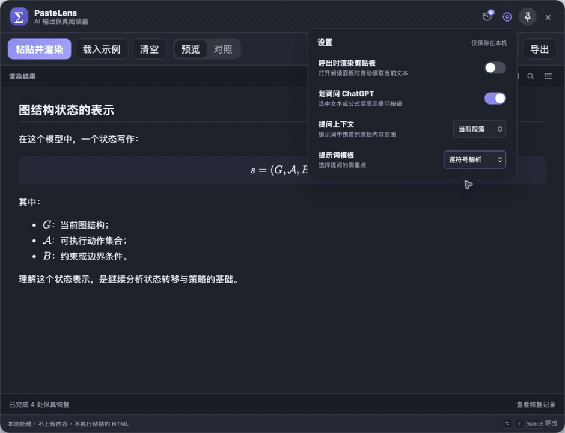

# PasteLens

PasteLens 是一个本地优先的 AI/终端输出阅读器：从 Codex、Claude、Termius 或其他应用复制文本，通过桌面悬浮球打开阅读面板，自动恢复并渲染 Markdown、LaTeX 与终端表格。其设计初衷是解决 codex cli 的 latex 渲染问题，终端输出的 codex 回复由于公式，格式无渲染难以阅读，在 codex cli 下通过选中复制或ctrl+o 复制最后一次回复，可在悬浮球中观看渲染后文本并进行公式复制，文字检索，超链接跳转，以及 ai 追问。

当前源码版本为 `v0.4.1`。预构建安装包及其版本请查看 [GitHub Releases](https://github.com/3241288994/PasteLens/releases)；源码更新与安装包发布独立进行。

## 演示



### 划词问 AI

选择上下文范围和提示词模板后，划选文本或公式即可生成包含原始 LaTeX 的提问内容，并打开 ChatGPT 供粘贴使用。



### 记录归类
可将记录归档到具体文件夹下并贴标签，后续可按文件夹或标签查询


## 安装

### Windows

Windows 10/11（x64）使用 `PasteLens_*_x64-setup.exe` 或 MSI 安装包。系统需要 Microsoft Edge WebView2 Runtime；Windows 10/11 通常已预装，安装器也会在缺失时引导安装。启动后悬浮球默认停靠在主显示器右侧，可用 `Alt + Shift + Space` 打开或隐藏阅读窗口，右键悬浮球可退出应用。

### macOS

当前预构建 DMG 面向 Apple Silicon（`arm64`），要求 macOS 11 或更高版本。请从 [GitHub Releases](https://github.com/3241288994/PasteLens/releases/latest) 下载 DMG，打开后将 `PasteLens.app` 拖入 `Applications`。

社区预览版使用 ad-hoc 签名，尚未经过 Apple 公证。首次启动若被 macOS 拦截，请在 Finder 中右键 `PasteLens.app`，选择“打开”并确认。

## 当前能力

- 可拖动悬浮球、贴边阅读面板与不抢焦点的图片上传状态卡。
- 保留“阅读 / 草稿本”；文件浏览与 PDF 预览模块已收缩为“图片快传”。
- 图片快传默认快捷键为 `Control + Option/Alt + V`，支持录制修改；从剪贴板读取图片，通过已有 SSH/SFTP 上传并复制服务器上的图片绝对路径。
- 上传显示读取、连接、传输、校验四个真实阶段；支持取消、重试同一张图片及再次复制绝对路径，成功提示 12 秒后收起，错误提示保留。悬浮球始终保持紫色。
- 上传后校验大小和 SHA-256，使用唯一文件名与私有权限，不覆盖现有截图；Mac 使用剪贴板变更序号保护上传期间新复制的内容。
- 阅读区中的文件链接恢复为点击复制路径，不再打开文件浏览面板。
- 右键悬浮球可打开/隐藏阅读窗口或退出应用。
- 可选在呼出阅读面板时自动读取并渲染当前剪贴板，偏好仅保存在本机，也保留手动粘贴入口。
- 不限数量的本机渲染历史，首次升级时会自动从旧浏览器存储迁移到 SQLite；历史内容不会上传。
- 科研项目库：每条历史可归入一个项目，支持新建、筛选、重命名与安全删除；删除项目只会将其历史移回收件箱。
- 多标签归档：可为历史添加多个标签，按标签组合筛选，并可勾选多条历史批量移动项目或添加标签。
- 当前文档顶部的“归档”菜单可直接选择/新建项目、添加或移除标签；首次归档会自动保存当前文档。
- 历史侧边栏支持搜索、置顶、键盘导航、滚动位置恢复、单条删除和清空。
- 全局快捷键：`Option/Alt + Shift + Space`。
- 标准 GFM Markdown、KaTeX 数学公式和 Mermaid 图表渲染。
- 兼容中文标点紧邻粗体标记，以及复制文本中 `**重点。 **后文` 这类结束标记前多空格的写法；仅调整显示，不回写原文、历史或文件，并保护代码、公式和链接地址。
- 代码块支持语法高亮、一键复制、自动换行与行号切换。
- 悬停公式显示操作条，可复制原始 LaTeX 或导出 SVG/PNG。
- 划选文字或公式后可生成带上下文的提示词，并从内置或自定义模板中选择提问方式，再打开 ChatGPT 供粘贴提问。
- 本地文件超链接悬停提示，点击即可复制对应文件路径。
- HTTP/HTTPS 网页链接使用系统默认浏览器打开。
- 恢复终端吞掉反斜杠后的裸 `[` / `]` 展示公式。
- 恢复 `(M_G)`、`(R^2>0)` 等高置信度行内公式。
- 根据 Unicode 显示宽度恢复带中文内容的终端表格。
- 预览与原文对照两种视图；粘贴、载入示例与新打开界面默认进入预览，可一键复制修复后的标准 Markdown。
- 支持导出长图 PNG、独立 HTML，并通过系统打印面板保存 PDF。
- 长文支持全文查找、标题目录与返回顶部。
- 公式与终端表格等结构恢复附带行号、理由与置信度记录；中文粗体兼容在渲染层处理，不计入原文恢复记录。
- 历史、项目和标签均保存在本机 SQLite 数据库中，可随时清空；不会上传内容，也不会执行其中的 HTML。

## 开发

需要 Node.js 20+、pnpm 和 Rust stable。

```bash
pnpm install
pnpm test
pnpm desktop:dev
```

macOS 如需使用项目内 Rust 工具链，请改用：

```bash
pnpm desktop:dev:mac
```

Windows PowerShell 若禁止执行 npm 生成的 `.ps1` 包装脚本，可使用等价的 `pnpm.cmd` 命令：

```powershell
pnpm.cmd install
pnpm.cmd test
pnpm.cmd desktop:dev
```

构建桌面应用。macOS 如未将 Rust 安装到系统路径，请使用项目内工具链脚本：

```bash
pnpm desktop:build
# macOS 本机推荐
pnpm desktop:build:mac
```

Windows 安装包输出到 `src-tauri/target/release/bundle/nsis/` 和 `src-tauri/target/release/bundle/msi/`。

### 图片快传

图片快传依赖本机 `ssh` / `sftp` 和服务器 `python3`，无需新增服务器服务。复用 `~/.ssh/config` 中的主机别名，例如：

```ssh-config
Host GPU-Server-Codex
  HostName example.org
  User ldy
  IdentityFile ~/.ssh/id_ed25519
```

首次点击顶部“图片快传”，确认服务器和接收目录并“保存并启用”。建议使用当前项目内的附件目录；默认 `~/attachments`。旧版文件面板的主机与默认上传目录会带入表单，仍需确认；不会使用最后浏览的目录，也不删除历史记录或服务器已有文件。

日常操作：截图到剪贴板（Mac `Control + Shift + Command + 4`）→ `Control + Option + V` 上传 → 看到“路径已复制”后，在原 Codex 对话 `Command + V`。剪贴板只包含服务器上的图片绝对路径，不添加提示词、引号或换行；上传成功不代表 AI 已读取。不会自动向终端输入或发送消息。如果上传期间复制了其他内容，不会覆盖新剪贴板，可点击“复制路径”。

界面支持浅色／深色、明显的快捷键键帽、图片缩略图和状态色；上传在原生后台执行，阅读窗口隐藏时也有效。上传中不允许修改目标，重复快捷键不会重复提交。失败重试使用保留的原图片，不重新读取可能已变化的剪贴板。仅内存保留本次失败图片，退出即释放。

SSH 使用严格主机密钥检查、非交互认证、连接与总传输超时，并设置 `ClearAllForwardings=yes`、独立连接，避免占用现有端口转发。首次连接请先在终端核对主机密钥。图片保留原始像素，限制为 3200 万像素 / PNG 编码后 30 MB；传输到隐藏临时文件，校验通过后生成唯一 `.png`，失败时尽力清理临时文件。状态卡的进度条表示阶段，不表示已传字节百分比。

验证：`pnpm test`、`pnpm test:ui`（需安装 Chrome）和 `cargo test --manifest-path src-tauri/Cargo.toml --lib`。真实 SSH 回归测试为显式启用：设置 `PASTELENS_TEST_HOST` 和 `PASTELENS_TEST_DIRECTORY` 后运行 `cargo test --manifest-path src-tauri/Cargo.toml --lib ssh_roundtrip -- --ignored --nocapture`；只上传生成的 1 像素测试图，校验后删除该测试文件。

只生成用于 GitHub Release 的 macOS DMG：

```bash
pnpm desktop:build:mac -- --bundles dmg
```

产物位于 `src-tauri/target/release/bundle/dmg/`。

启动脚本会优先使用项目内 `.tools/` 中的 Rust 工具链；不存在时自动使用系统 Rust。

只调试渲染界面时可以运行：

```bash
pnpm dev
```

然后访问 `http://127.0.0.1:1420`。浏览器模式不具备原生悬浮窗能力，但可以测试文本恢复与渲染。

## 保真原则

PasteLens 的恢复层只补充分隔符和结构，不生成或改写公式。无法高置信度识别的输入保留原文。代码围栏、行内代码和普通括号不会进入恢复流程。

处理管线：

```text
粘贴文本
  → 移除 ANSI/控制字符
  → 识别代码、公式和终端表格
  → 生成带置信度的标准 Markdown
  → remark/GFM
  → KaTeX
  → 本地 WebView
```

## 项目结构

- `src/recovery/`：可独立测试的终端 Markdown 恢复引擎。
- `src/render.ts`：GFM、数学公式到安全 HTML 的渲染管线。
- `src/main.ts`：阅读面板交互。
- `src/ball.ts`：悬浮球点击和拖动交互。
- `src-tauri/`：原生窗口、定位、快捷键与剪贴板能力。
- `tests/`：防误判与保真恢复测试。

## 已知边界

- 终端复制已经彻底删除的字符无法无歧义恢复。
- 首版表格恢复要求存在多段 `━`、`─` 或 `═` 分隔线。
- Linux Wayland 的全局快捷键和窗口定位将在后续单独适配。

## License

MIT
